<!-- Troque Mateusds pelo seu usuário do GitHub. Os SVGs ficam em assets/ no mesmo repositório. -->

  

 

 

 

<!--
Cobrinha: crie .github/workflows/snake.yml (e rode uma vez em Actions > Run workflow)

name: Generate Snake
on:
  schedule: [{ cron: "0 0 * * *" }]
  workflow_dispatch:
permissions:
  contents: write
jobs:
  generate:
    runs-on: ubuntu-latest
    steps:
      - uses: Platane/snk/svg-only@v3
        with:
          github_user_name: ${{ github.repository_owner }}
          outputs: dist/github-contribution-grid-snake-dark.svg?palette=github-dark
      - uses: crazy-max/ghaction-github-pages@v3
        with:
          target_branch: output
          build_dir: dist
        env:
          GITHUB_TOKEN: ${{ secrets.GITHUB_TOKEN }}
-->
